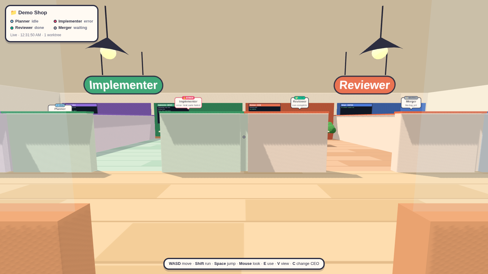
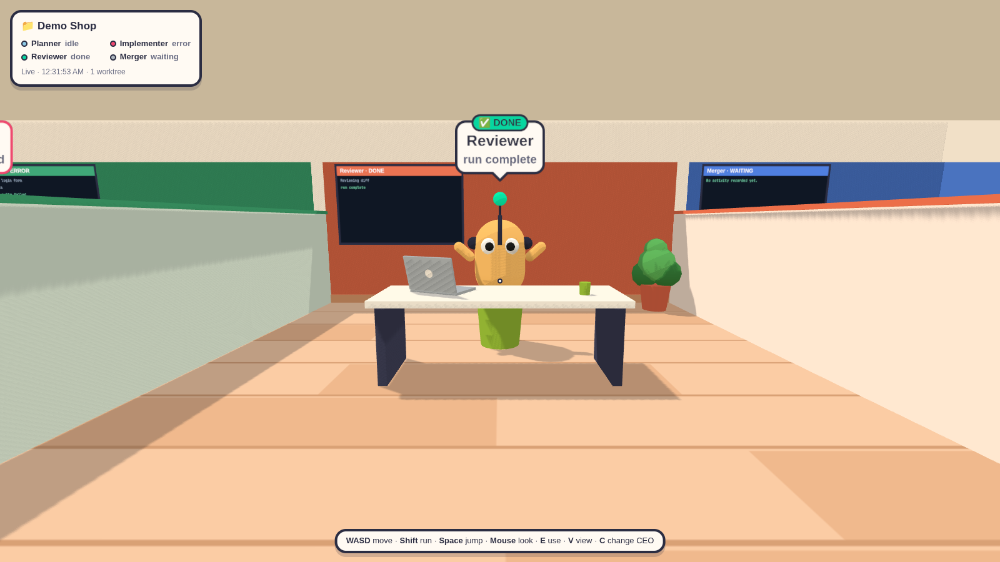
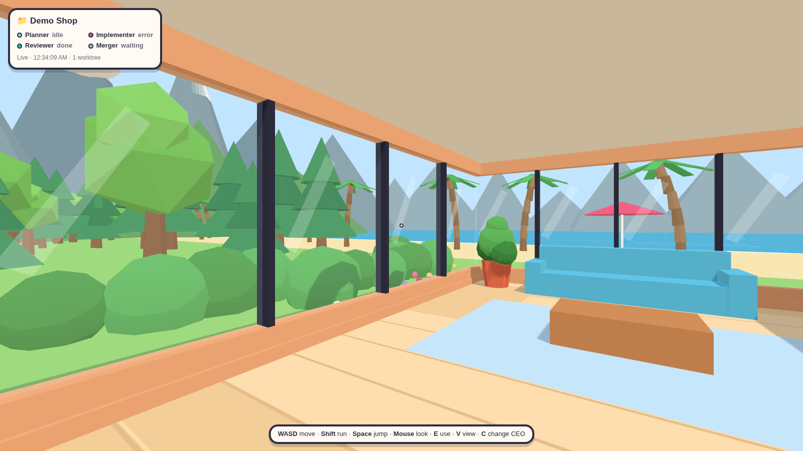
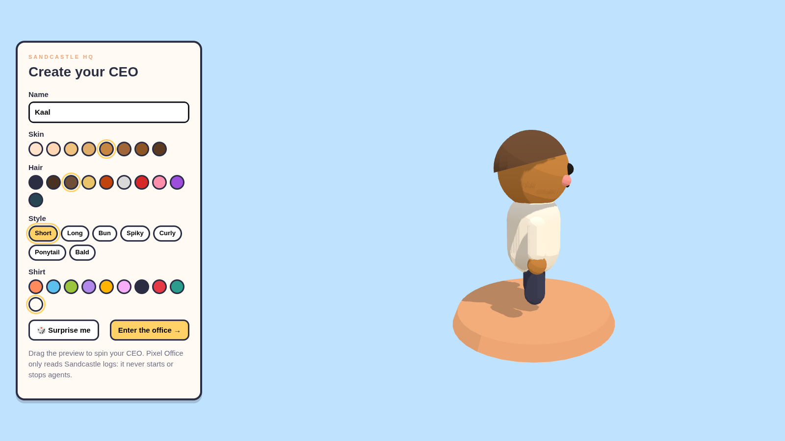
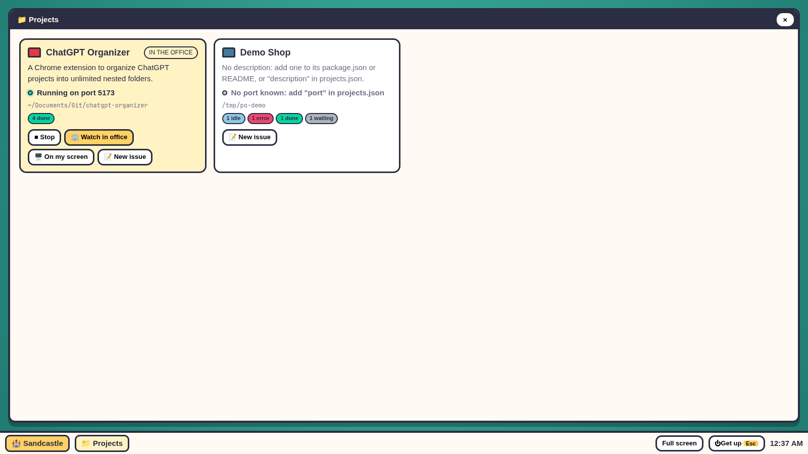
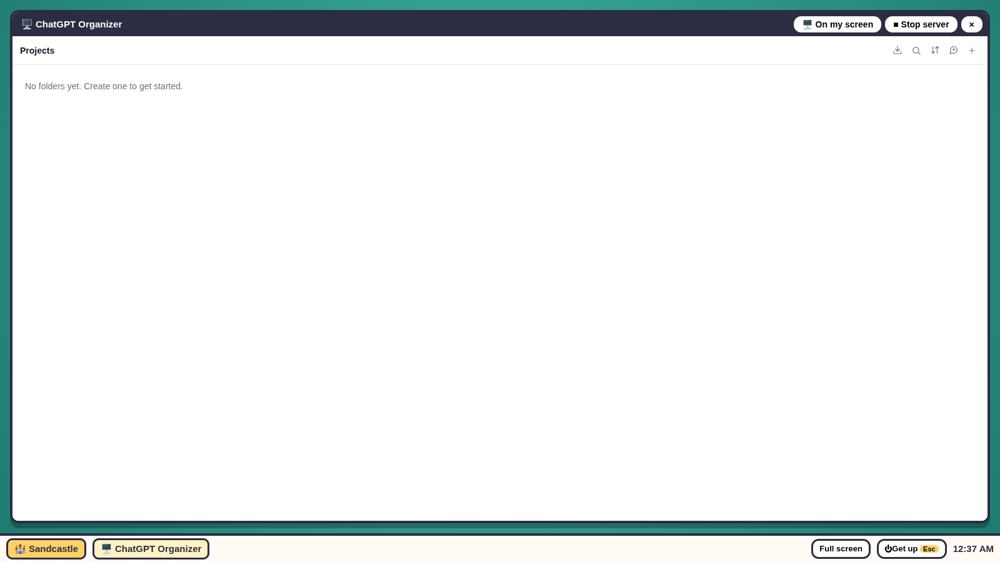
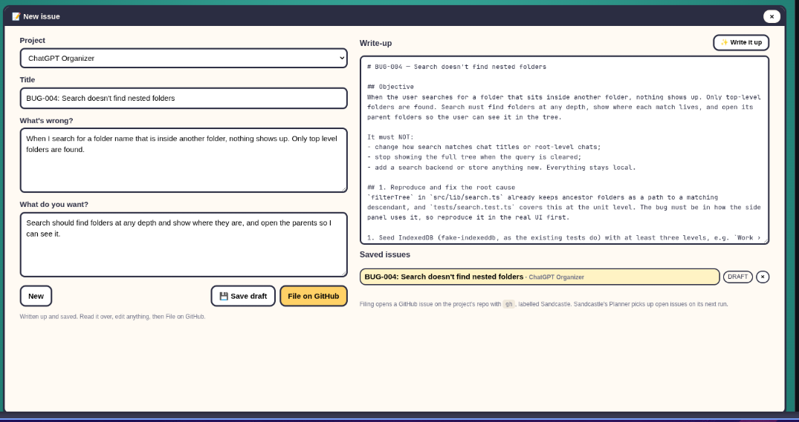
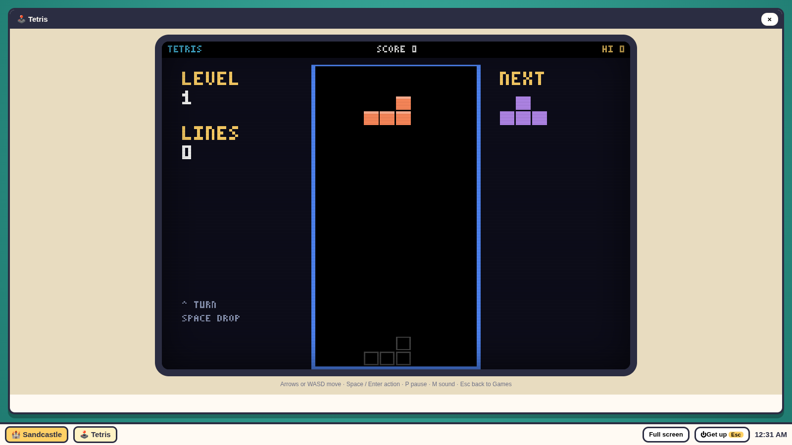
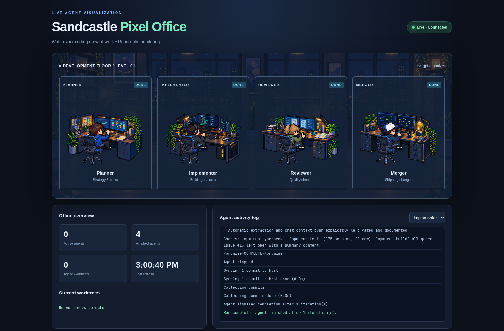

# Sandcastle Pixel Office

A lightweight office for watching local [Sandcastle](https://github.com/ai-hero-dev/sandcastle) agent activity. In V3 you make your own CEO and walk round a 3D office, in first or third person: the **Planner**, **Implementer**, **Reviewer**, and **Merger** each have a cubicle where they act out their status, with their log on the wall, and the file stack in the CEO's room switches between your Sandcastle projects. The V2 pixel-art dashboard is still at `/2d`.

> **Local monitor.** Pixel Office shows what your Sandcastle agents are doing from the logs they write. From the CEO's computer you can file a GitHub issue, which starts Sandcastle on it straight away if you give the project a `"sandcastle"` command in `projects.json`, and run and stop a project's app with its `"run"` command.



## Screenshots

| | |
|---|---|
|  |  |
| **An agent at work.** Each one acts out its status at its desk, with its log on the wall. | **The lounge.** Done or idle agents wander off here, to the sofa and the view. |
|  |  |
| **Create your CEO.** Skin, hair, style and shirt, then walk in. | **Projects.** Each app, what it's for and its port, with Run, Stop, Watch in office and On my screen. |
|  |  |
| **Watch in office.** A running app opens in a window on the computer. | **New issue.** Write a note and Claude writes it up as a full issue, then file it on GitHub. |
|  |  |
| **Games.** Tetris, Snake, Invaders, Breakout and Pong. | **V2 dashboard**, still at `/2d`. |

## Features

- 3D office: create your CEO, then walk with **WASD** and look with the mouse, in first person or third (**V** switches, the mouse wheel zooms)
- Five rooms: the CEO's room and a cubicle for each agent, read left to right from the hallway
- **Project file stack** in the CEO's room: walk up to it and press **E** to switch projects
- Agents act out their status at their desks while they work. When they're done, idle or waiting, they wander off to the lounge sofas, the windows or a colleague's desk
- Press **E** by an agent, wherever it is, to talk to it: it tells you its job, its status and what it's up to, with its log underneath
- A lounge with windows onto a beach, the sea, woods and mountains
- A retro computer on the CEO's desk: sit in the CEO's chair and press **E**, and its desktop fills the screen:
  - **Games**: Tetris, Snake, Invaders, Breakout and Pong, with high scores kept in your browser
  - **Projects**: each app, what it's for, the port it runs on and whether it's up, with **Run** and **Stop** for its dev server; once its server is up, pick **Watch in office** (a window on the computer) or **On my screen** (your normal browser, outside VS Code or wherever the office is)
  - **New issue**: write a title, what's wrong and what you want. **Write it up** has Claude Code read the project and turn that into a full issue (an ID like `FEAT-008`, objective, numbered sections, tests, acceptance criteria) for you to edit. Then save it as a draft or file it as a GitHub issue (with `gh`, in the project's folder, labelled `Sandcastle`) for the Planner to pick up
- Agent status: waiting, working, done, idle, or error, refreshed every **3 seconds**
- V2 pixel-art dashboard at `/2d`, with recent logs, worktree names and overview counts
- Runs using **Python's standard library**, with no Python packages or Node to install

## Requirements

- Python 3
- A local Sandcastle project that writes agent log files under `.sandcastle/logs/`
- A modern web browser

Sandcastle itself is **not included** in this repository and must be configured separately.

## Getting started

### 1. Clone the repository

```bash
git clone https://github.com/kaaldev73/sandcastle-pixel-office.git
cd sandcastle-pixel-office
```

### 2. Point the dashboard at your Sandcastle project

Set `SANDCASTLE_PROJECT` to the absolute path of the project you want to watch:

```bash
export SANDCASTLE_PROJECT="/absolute/path/to/your/sandcastle-project"
```

The project should have logs at:

```text
<your-project>/
└── .sandcastle/
    ├── logs/
    │   └── ... agent .log files
    └── worktrees/
        └── ... agent worktrees
```

If you don't set `SANDCASTLE_PROJECT`, the current server script uses the author's local ChatGPT Organizer path as a default. **Most users should set the environment variable explicitly.**

To watch several projects, copy `projects.example.json` to `projects.json` and list them; each one becomes a file in the CEO's stack. `projects.json` is git-ignored, and without it Pixel Office watches just `SANDCASTLE_PROJECT`.

```json
{
  "projects": [
    { "id": "my-app", "name": "My App", "path": "~/code/my-app" }
  ]
}
```

Each project can also have a `"description"` (what the app is for), a `"port"` (where it runs) and a `"url"` (where to open it), for the Projects folder on the CEO's computer. Without them it reads the description from the project's `package.json` or README, and guesses the port from its dev scripts (Vite's 5173 if nothing says).

To run and stop a project's app from the CEO's computer, give it `"run"`, the command that starts its server (run in the project's folder, without a shell), with the `"port"` it listens on, and `"page"` if its page isn't at `/`. For a Vite app, pin the port so it can't wander off to another: `"run": "npm run dev -- --port 5173 --strictPort", "port": 5173`. Its output shows on the computer while it starts, and once it's listening you pick **Watch in office** or **On my screen**. Apps started this way stop when you press **Stop** or stop Pixel Office; one already running from elsewhere is left alone.

Or, for an app with nothing to run, give it `"serve"`: its built folder (say `"dist"`), and `"page"` if the app's page isn't that folder's `index.html`. Pixel Office serves the folder, read-only, on a local port of its own (its `"port"`, or one worked out from its id). The port stays the same between runs because the browser keeps what the app saves for each port separately. A Chrome extension opened this way runs as a plain page: whatever needs Chrome's extension features won't work, and it keeps its own data, apart from the installed extension's.

To have Sandcastle start as soon as you file an issue, give the project `"sandcastle"`, the command that starts it (run in the project's folder, without a shell), say `"sandcastle": "npm run sandcastle"`. Filing then starts it, so the Planner picks your issue up now, unless Sandcastle is already running in that folder (from here or a terminal of yours), in which case it picks it up next round. Its card in **Projects** shows whether it's running and what it printed last, with **Start Sandcastle** and **Stop Sandcastle**; the same button is on **New issue**, next to **File on GitHub**, for the project picked there. A run started this way stops when you press **Stop Sandcastle** or stop Pixel Office. It's given your GitHub CLI login as `GH_TOKEN` (unless that's set already), for Sandcastle to pass into its Docker sandboxes. Each run starts Docker sandboxes and uses your Claude plan.

Filing an issue from the computer needs the [GitHub CLI](https://cli.github.com/) installed and logged in (`gh auth login`). **Write it up** also needs [Claude Code](https://claude.com/claude-code) installed and logged in (`claude`); it runs headless in the project's folder, can only read files there, and uses your Claude plan.

#### Several projects at once

Every project in `projects.json` shows on the CEO's computer: a card in **Projects**, a file in the stack, and a choice under **New issue**. The cubicles show one project's agents at a time; pick its file from the stack to switch.

To run more than one app at once, give each its own port: 5173, 5174, 5175 and so on. If two use the same port, the second won't start, and the computer says something is already running on that port. Each entry looks like this:

```json
{ "id": "my-app", "name": "My App", "path": "~/Documents/Git/my-app",
  "run": "npm run dev -- --port 5174 --strictPort", "port": 5174 }
```

Only `"path"` is required. Without `"run"` the card has no Run button; without `"port"` Pixel Office guesses it from the project's dev script.

#### Let your agent add your projects

Paste this to your coding agent (Claude Code or another), opened in the `sandcastle-pixel-office` folder:

```text
Add my Sandcastle projects to Sandcastle Pixel Office.

1. Find my projects: folders under ~/Documents/Git (or wherever I keep my code) that have a .sandcastle
   folder. Show me the list and ask which to add before writing anything.
2. Read projects.example.json and the "Several projects at once" part of README.md for the format.
3. Create projects.json in this folder (or add to it if it's there, keeping what's in it) with one entry
   per project: "id" (short, lowercase, unique), "name", "path" (with ~ for my home folder).
4. For each project with a dev server, add "run" and "port", read from its package.json scripts and its
   Vite or other config. Give every project its own port (5173, 5174, 5175, ...), pin it in the command
   (for Vite: "npm run dev -- --port 5174 --strictPort"), and add "page" if its page isn't at /.
5. Don't change anything in the projects themselves. Check projects.json is valid JSON, show it to me,
   and tell me to reload the office page (Pixel Office reads projects.json fresh each time).
```

### 3. Start Pixel Office

```bash
python3 server.py
```

Open **http://127.0.0.1:8765** in your browser.

To use a different port:

```bash
python3 server.py 9000
```

Then open **http://127.0.0.1:9000**.

### 4. Run Sandcastle separately

Run Sandcastle from its own project terminal using that project's documented startup command, or give the project `"sandcastle"` in `projects.json` to have Pixel Office start it when you file an issue. The dashboard will detect matching log updates automatically either way.

## How monitoring works

The local Python server serves the 3D office at `/`, the V2 dashboard at `/2d`, the project list at `/api/projects`, and one project's status at `/api/status?project=<id>`. Every 3 seconds the page requests a fresh snapshot.

For each agent role, the server looks for its newest matching `*.log` file in `.sandcastle/logs/`. It uses recent log content and modification times to **infer** statuses; these are not authoritative agent-process states. If no matching log exists, the role shows *waiting*. The UI also lists directory names in `.sandcastle/worktrees/`.

If your Sandcastle setup writes logs elsewhere or uses different filenames, the dashboard may show no activity even while agents are running.

## Privacy and security

- The server binds to **127.0.0.1** by default; it is intended for local use only.
- Pixel Office reads logs and worktree names. It runs agent commands only where you've given a project `"sandcastle"` in `projects.json`, when you file an issue or press **Start Sandcastle**.
- The server applies best-effort redaction to some token and password patterns, but **redaction is not comprehensive**. Agent logs may still reveal private paths, prompts, code, or other sensitive information.
- Do not expose the local server to the public internet or share live logs without reviewing them.
- Do not commit secrets or copied agent logs to this repository.

## Troubleshooting

**Page doesn't open:** Check that `python3 server.py` is still running and that you used the displayed port. If the port is occupied, choose a different one.

**All agents show "waiting":** Confirm `SANDCASTLE_PROJECT` points to the correct directory and that `.sandcastle/logs/` contains filenames ending in the corresponding role name and `.log`.

**Status looks stale or wrong:** Status is heuristic: old logs become *idle*, and errors are detected from recent text patterns. Refresh the browser or inspect the underlying Sandcastle logs directly.

**No worktrees appear:** Check whether your project creates `.sandcastle/worktrees/`. Missing or empty directories are shown as no worktrees.

### Starting Sandcastle from the office

**Sandcastle stops with `PromptError` and `exitCode: 4`, and the Planner's log says `gh` wants `gh auth login`:** The Planner runs in a Docker sandbox, which can't use the GitHub login stored in your computer's keyring, so `gh issue list` fails in there. Sandcastle passes GitHub access into the sandbox only if `GH_TOKEN` is set when it starts. Pixel Office sets it from `gh auth token` for runs it starts, so check that `gh` is logged in on your computer (`gh auth status`; if not, `gh auth login`), then stop and start Pixel Office so it has the change. Started from a terminal, run it as `GH_TOKEN=$(gh auth token) npm run sandcastle`.

**`GH_TOKEN=$(gh auth token) ...` doesn't work as the `"sandcastle"` command:** Pixel Office runs commands without a shell, so `$(...)` isn't expanded. Use just `"sandcastle": "npm run sandcastle"`: Pixel Office adds `GH_TOKEN` itself.

**The Planner still shows *error* after you've fixed something:** Its status comes from its newest log, which is still the failed run's. Start Sandcastle again (**Start Sandcastle** in **Projects**, or file an issue) and it changes once the new run writes to the log.

**Filing an issue doesn't start Sandcastle:** Check the project has `"sandcastle"` in `projects.json`, and reload the office page. If the message says Sandcastle is already running, it found a Sandcastle process in that project's folder (perhaps one you started in a terminal): that run picks up the issue at the start of its next round. Pixel Office won't start a second one alongside it.

**The card says "Sandcastle stopped (exit code ...)":** Its last lines show on the card; the agent logs in `.sandcastle/logs/` have the rest. Check that Docker is running (`docker ps`) and that the project's `.sandcastle/.env` has the Claude token Sandcastle needs.

**Sandcastle ran but did nothing:** The Planner found no open, unblocked issues and stopped (`No unblocked issues to work on`). Check the issue is open on the repo Sandcastle reads (`gh issue list`, in the project's folder).

**"Couldn't start Sandcastle":** The `"sandcastle"` command couldn't be run: check it's right and works when you run it yourself in the project's folder.

**A project's agents all show *waiting*:** Check its `"path"` in `projects.json` still exists. A folder under `/tmp` is gone after a restart.

**Sandcastle stopped when Pixel Office was restarted:** A run started from the office stops with it. Before restarting `server.py`, check no Sandcastle strip is showing along the bottom (or wait for it to finish); afterwards press **Start Sandcastle** and the Planner picks the open issues up again.

**The Planner isn't at his desk though you've just filed an issue:** Agents go to their desks while they're *working*, and planning takes about a minute: then the Planner is *done* and the Implementer, Reviewer and Merger take over in turn. Look at whose status is *working* (top left, or the strip along the bottom).

### The strip along the bottom

**No strip while Sandcastle is running:** It shows only for runs started from the office, not ones in a terminal. Reload the page after updating Pixel Office, since the page keeps the version it loaded.

**The strip says "planning" and names no agents:** The page is newer than the server. Restart `python3 server.py` (see above: it stops a run it started).

**Its buttons don't respond in the office:** The mouse is captured for looking around. Press **Esc** to get the pointer back, then click.

**No Watch in office or On my screen on it:** They show once the project's app is running. Press **▶ Run app** (it needs `"run"` in `projects.json`), or start the app yourself.

### After Sandcastle has changed your app

**The change doesn't show in the app or Chrome extension:** Sandcastle changes the source and merges it into your branch, but doesn't rebuild what you're running. For a Chrome extension loaded unpacked from `dist/`, run `npm run build` in the project, press reload on it in `chrome://extensions`, and reopen its window or side panel. A dev server (`"run"`) usually reloads by itself; if not, stop and run it again.

**The change isn't on GitHub:** Sandcastle merges into your local branch and doesn't push. Push it yourself (`git push`, in the project's folder) when you're happy with it.

**The issue is still open on GitHub after Sandcastle finished:** Sandcastle's Merger closes it when it merges the work, so it probably wasn't merged: look at the Merger's log in `.sandcastle/logs/` (or press E at its desk). Issues the Planner found blocked by another wait for that one to be done first.

## Project files

| File | Purpose |
| --- | --- |
| `client/` | The 3D office's source (TypeScript, three.js, Vite) |
| `client/src/computer.ts` | The CEO's computer: the desktop with the Games and Projects folders and the issue notepad |
| `client/src/games/` | The CEO's retro computer: the arcade menu and its games |
| `client/src/vendor/agent-office/` | Parts adapted from agent-office (MIT), see `THIRD_PARTY_NOTICES.md` |
| `dist/` | The built 3D office, committed so `python3 server.py` needs no Node |
| `index.html` | V2 dashboard UI, pixel-art visuals, and client-side polling |
| `server.py` | Local HTTP server: log/worktree status, filing issues, and starting apps and Sandcastle |
| `projects.example.json` | Example list of projects for the CEO's file stack |
| `.gitignore` | Excludes Python cache, local environment files, `projects.json` and `node_modules/` |

## Working on the 3D office

You only need Node to change the 3D office. Run `npm install`, start `python3 server.py`, then `npm run dev` for a live-reloading copy on Vite's port (it forwards `/api` to the Python server). Run `npm run build` to rebuild `dist/` before committing.

## Current limitations

- Shows **one** Sandcastle project's agents at a time (switch at the file stack).
- Does not run or manage agents.
- Status is inferred from log files, not a direct Sandcastle process API.
- Does not include authentication or remote hosting support.
- No bundled installer, packaging, or automated setup script.

## Acknowledgments

Special thanks to **[Matt Pocock](https://github.com/mattpocock)** for his work on Sandcastle and for inspiring this pixel-art view of the agent workflow.

Thanks to **K¥Ø** for inspiring me to build this.

Thanks to **[agent-office](https://github.com/AgentSystemLabs/agent-office)** by AgentSystemLabs: the V3 3D office's characters, movement and materials are adapted from it (MIT License); see `THIRD_PARTY_NOTICES.md`.

## Contributing

Issues and pull requests are welcome. Please avoid including tokens, private logs, or personal filesystem paths in bug reports.

## License

No license has been added yet. Until a license is selected, the repository does not grant general reuse or redistribution rights beyond what applicable law allows.
